  <a href="https://krupakarsb.github.io"><b>Website and live demo</b></a> ·
  <a href="https://krupakarsb.github.io/assets/Krupakar-S-Bilichod-Resume.pdf"><b>Resume</b></a> ·
  <a href="https://www.linkedin.com/in/krupakarsb"><b>LinkedIn</b></a> ·
  <a href="mailto:krupakarsb@gmail.com"><b>Email</b></a>

## Hi, I'm Krupakar, or KSB

I'm a final-year B.Tech Cyber Security student at GM University, Davangere, graduating in 2027. I build tools that make security work simpler and easier to verify.

**Open to:** internships and graduate roles as a Security Analyst (L1) or Cyber Security Consultant, available from 2027.

## Featured project

**zlang** is my first own project: a language and console for cyber security work. [Try the demo in your browser](https://krupakarsb.github.io/#try).

**Zini** (in development) is a planned AI assistant for zlang. It will only suggest, and you stay in control of what runs.

## Skills

Computer networking · Linux · Python · Git · Cyber security fundamentals

## CTFs and labs

- **Ascent: Override.exe CTF**, Scaler School of Technology, May 2026
- **[Advent of Cyber 2025](https://tryhackme-certificates.s3-eu-west-1.amazonaws.com/THM-OU2Q2KIAEF.pdf)**, TryHackMe, December 2025

## Courses and certificates

| Certificate | Issued by | Date |
|---|---|---|
| [AWS Cloud Practitioner CLF-C02 course](https://www.udemy.com/certificate/UC-7411b92f-67b3-411b-8fca-2a8654aba6c2/) | Udemy | Feb 2026 |
| Vulnerability Assessment and Penetration Testing, industry-integrated program | GM University | Jul 2025 |
| [Networking Fundamentals on Google Cloud](https://www.cloudskillsboost.google/public_profiles/b478eca2-c6cd-421d-a5d9-c17e0866634b/badges/11717947) | Google Cloud Skills Boost | Sep 2024 |
| [Foundations of Cybersecurity](https://www.coursera.org/account/accomplishments/records/ELZ3V6QZ8D3S) | Google | Mar 2024 |
