  <a href="https://krupakarsb.github.io"><b>Website and live demo</b></a> ·
  <a href="https://github.com/manjim-dev/manjim"><b>manjim</b></a> ·
  <a href="https://github.com/delbina/delbina"><b>delbina</b></a> ·
  <a href="https://krupakarsb.github.io/assets/Krupakar-S-Bilichod-Resume.pdf"><b>Resume</b></a> ·
  <a href="https://www.linkedin.com/in/krupakarsb"><b>LinkedIn</b></a> ·
  <a href="mailto:krupakarsb@gmail.com"><b>Email</b></a> ·
  <a href="https://krupakarsb.github.io/bitpillars/"><b>BitPillars games</b></a>

## Hi, I'm Krupakar, or KSB

**Cyber Security · GRC · ISO 27001 · SOC 2 · DPDP · B.Tech '27 · Creator of zlang, manjim & delbina · Hasfragis core team**

I'm a final-year B.Tech Cyber Security student at GM University, Davangere, graduating in 2027. I work on the governance, risk and compliance side of security, and I build tools that turn controls and evidence into something anyone can check.

**Open to:** internships and graduate roles in GRC, IT audit, cyber risk, security compliance and privacy, from 2027.

## Experience

**Cybersecurity Intern**, UNLOX (September batch), certificate of internship completion

- Capstone: designed and built a centralized log monitoring and threat detection system with the ELK Stack, bringing logs from Windows and Kali Linux endpoints into one central server for monitoring, detection and review.

## Projects

**[Zlang](https://krupakarsb.github.io)**, my first own project, is a language and console for cyber security work, with governance built in. Every network command is checked against an approved scope, actions land in a tamper-evident log, and a lockdown freezes the install while saving a signed evidence file that can be verified later. It installs on Windows as a tray app with 59 commands. The source is private; [try the demo in your browser](https://krupakarsb.github.io/#try).

- **Zini** (in development): a planned AI assistant for Zlang. It only suggests; you stay in control of what runs.

**[manjim](https://github.com/manjim-dev/manjim)** ([PyPI](https://pypi.org/project/manjim/)) is an open-source GRC and IT audit CLI with zero dependencies. It audits a project against checks mapped to ISO 27001:2022 Annex A and SOC 2 and gives a hygiene score, builds a risk register with inherent and residual risk and DPDP Act flags, and seals reports so any later change is detected. Reports come out as Markdown, CSV, JSON or SARIF for GitHub code scanning.

**[delbina](https://github.com/delbina/delbina)** ([PyPI](https://pypi.org/project/delbina/)) is an open-source Python library and drop-in proxy that cuts the token cost of long AI chats and agents. It compresses old context in a cache-friendly way, redacts secrets, and keeps a compaction log of what was changed.

- **[delbina-sum](https://github.com/delbina/delbina-sum)** (in progress): a small summarizer model trained to keep exact facts such as IDs, paths and versions. It is released only once it passes all its evaluation bars.

**[Hasfragis](https://hasfragis.github.io)** (team project, core team member) is a digital forensics toolkit that makes evidence tamper-evident and checkable: file hashes, a Merkle root, a signed custody ledger and an incident timeline.

## Skills

- **Frameworks:** ISO 27001:2022 · SOC 2 · DPDP Act · risk registers · audit evidence
- **Security:** log monitoring · vulnerability assessment · digital forensics basics · networking · Linux
- **Tools:** Python · Git · GitHub Actions · PyPI packaging · ELK Stack

## Certifications, courses and labs

| Name | Issued by | Date |
|---|---|---|
| [AWS Cloud Practitioner CLF-C02 course](https://www.udemy.com/certificate/UC-7411b92f-67b3-411b-8fca-2a8654aba6c2/) | Udemy | Feb 2026 |
| Vulnerability Assessment and Penetration Testing, industry-integrated program | GM University | Jul 2025 |
| [Networking Fundamentals on Google Cloud](https://www.cloudskillsboost.google/public_profiles/b478eca2-c6cd-421d-a5d9-c17e0866634b/badges/11717947) | Google Cloud Skills Boost | Sep 2024 |
| [Foundations of Cybersecurity](https://www.coursera.org/account/accomplishments/records/ELZ3V6QZ8D3S) | Google | Mar 2024 |

**CTFs and labs**

- **Ascent: Override.exe CTF**, Scaler School of Technology, May 2026
- **[Advent of Cyber 2025](https://tryhackme-certificates.s3-eu-west-1.amazonaws.com/THM-OU2Q2KIAEF.pdf)**, TryHackMe, December 2025

## BitPillars

**[BitPillars](https://krupakarsb.github.io/bitpillars/)** is my little game lab: tiny pixel games that are fast, chill and satisfying, all free to play in the browser.
